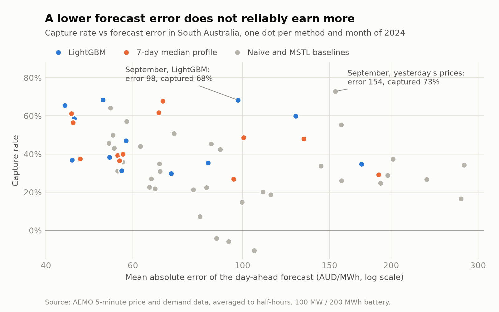
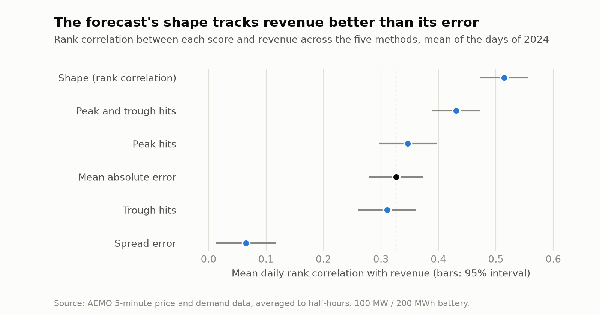

# How much is a price forecast worth?

*Battery arbitrage in Australia's National Electricity Market (NEM). Work in progress.*

A grid battery earns money by charging when electricity is cheap and discharging when it is expensive, so every decision rests on a price forecast. This project asks whether a forecast that is more accurate by the usual metrics (MAE) actually earns more. It backtests a year of day-ahead scheduling on public AEMO data, optimizing each day with a mixed-integer linear program.

<picture>
  <source media="(prefers-color-scheme: dark)" srcset="figures/capture_vs_mae-dark.png">
  
</picture>

## Data

AEMO's public 5-minute regional reference price (RRP, AUD/MWh) and demand, averaged to 30-minute intervals. Downloaded on demand by `src/nem_battery/data.py`.

## Model

For each day, choose charge $c_t$ and discharge $d_t$ (MW) in each of 48 half-hours to maximize

$$\sum_t p_t\,(d_t - c_t)\,\Delta t \;-\; \kappa \sum_t d_t\,\Delta t$$

subject to state-of-charge dynamics $s_t = s_{t-1} + \eta_c c_t \Delta t - d_t \Delta t / \eta_d$, capacity and power limits, and $s_{48} = s_0$. Here $p_t$ is the price, $\Delta t$ the interval length, $\eta_c, \eta_d$ the charge and discharge efficiencies and $\kappa$ a degradation cost per MWh.

A binary mode variable stops the battery from charging and discharging in the same interval. Without it, a linear program would do exactly that whenever prices go negative, which they often do in South Australia: it would burn energy through conversion losses to be paid for consuming. The battery is 100 MW / 200 MWh with ~85% round-trip efficiency.

## Backtest

For each day $D$:
1. forecast its 48 prices using data up to $D-1$;
2. optimize on the forecast;
3. settle the plan at the prices that actually cleared.

The yardstick is the revenue under perfect foresight, so the headline metric is the **capture rate**: realized revenue ÷ perfect-foresight revenue.

## Forecasts

Three naive baselines repeat recent prices: yesterday's, the same day last week, and the median of each half-hour over the previous seven days. Two models then try to do better:

- **MSTL** splits the last eight weeks into a trend, a daily cycle and a weekly cycle, and carries them forward one day.
- **LightGBM** learns from lagged prices, lagged demand and the calendar. It is refitted at the start of each month on every earlier day, and it minimizes absolute error, because South Australian prices spike too often for squared error.

Both models see only data up to the end of the day before the one they forecast, and the tests check that.

## Results (South Australia, 2024)

| Forecast | MAE (AUD/MWh) | Revenue (AUD m) | Capture rate |
|---|---|---|---|
| Perfect foresight | 0 | 33.5 | 100% |
| LightGBM | 76 | 15.7 | 47% |
| 7-day median profile | 80 | 14.6 | 44% |
| Same day last week | 123 | 11.0 | 33% |
| Yesterday | 106 | 9.7 | 29% |
| MSTL | 102 | 9.4 | 28% |

Over the whole year, the most accurate forecast also earns the most. Month by month, however, that holds in only six months out of twelve. In September, for example, yesterday's prices missed by 154 AUD/MWh on average and still captured 73% of the possible revenue, more than LightGBM did with an error of 98.

MSTL shows the same gap from the other side. Its first version added the weekly cycle half-hour by half-hour, and with only eight weeks of data that shape was mostly noise. The optimizer traded on the noise, and in June 2024 it captured almost nothing. Keeping only the weekly cycle's daily level raised its capture rate to 19% that month, while its error improved by only 10 AUD/MWh. A small change in accuracy was a large change in money, because the battery cares about when the price peaks and troughs, not about the average miss.

## What the battery needs from a forecast

If the average error is not what earns money, what is? A battery charges in a few cheap half-hours and discharges in a few dear ones, so it needs the day's shape more than the level of each price. I scored every daily forecast in four more ways:

- **Shape:** the rank correlation between the forecast and the actual prices within the day, which asks whether the forecast puts the half-hours in the right order.
- **Peak hits and trough hits:** the share of the day's four dearest (or cheapest) half-hours that the forecast also picks. Four half-hours are what the battery needs for one full discharge.
- **Spread error:** how far the forecast's gap between the dearest and the cheapest half-hours is from the actual gap.

Then, for each day, I ranked the five methods by each score and compared that ranking with their ranking by revenue.

<picture>
  <source media="(prefers-color-scheme: dark)" srcset="figures/score_agreement-dark.png">
  
</picture>

The shape is the best guide: its ranking agrees with the revenue ranking at 0.51 on an average day, against 0.33 for MAE. Since both are measured on the same days, the gap of 0.19 can be tested directly, and its 95% interval runs from 0.13 to 0.24. Hitting both the peaks and the troughs comes second, at 0.43. Peaks or troughs alone are no better than MAE, and the spread error says almost nothing, because a forecast can get the size of the gap right while putting it at the wrong time.

Month by month, however, no score does better than MAE: the shape, the combined hits and MAE each pick the top earner in six months out of twelve. Twelve months are too few to tell them apart, so the case for the shape rests on the daily comparison.

The practical lesson is that a forecast for a battery should be chosen, and could be trained, on how well it orders the hours of each day, not only on its average error.

## Limitations

- **Day-ahead plan:** the plan is fixed a day ahead. Real batteries rebid every five minutes, so these figures are a floor.
- **No ancillary services:** frequency-control (FCAS) revenue is excluded.
- **Price taker:** the battery does not move the price.
- **One cycle a day in the scores:** peak and trough hits look at the four dearest and cheapest half-hours, which is one full cycle; on some days the optimizer cycles twice.
- **One region and one year:** all results are for South Australia in 2024.

## Reproduce

```bash
uv sync
uv run python scripts/run_backtest.py --region SA1 --start 2024-01-01 --end 2025-01-01  # about 50 minutes
uv run python scripts/compare_metrics.py
uv run python scripts/make_figures.py
```

The forecasts are saved to `data/processed/`. To re-run the optimization alone, for example after changing the battery, add `--reuse-forecasts` to `run_backtest.py`; it then takes about a minute.

The checks that run in CI:

```bash
uv run ruff check . && uv run ruff format --check . && uv run mypy && uv run pytest
```
